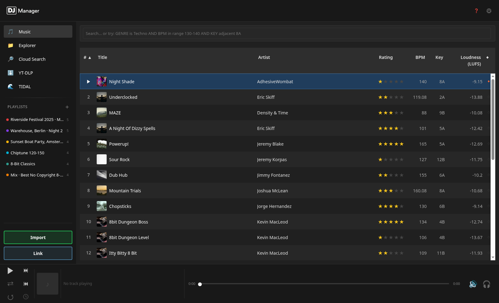
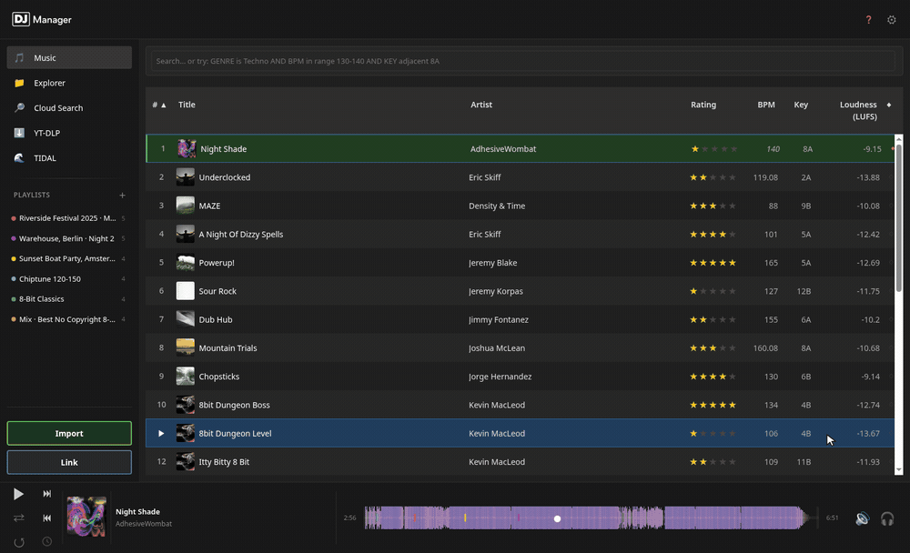
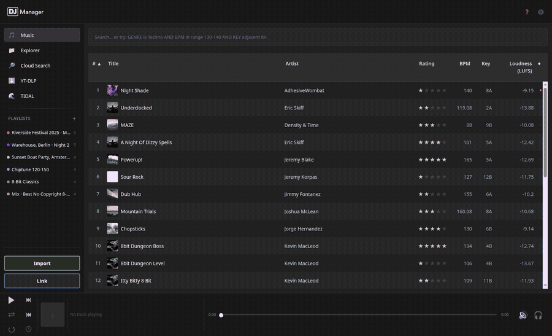
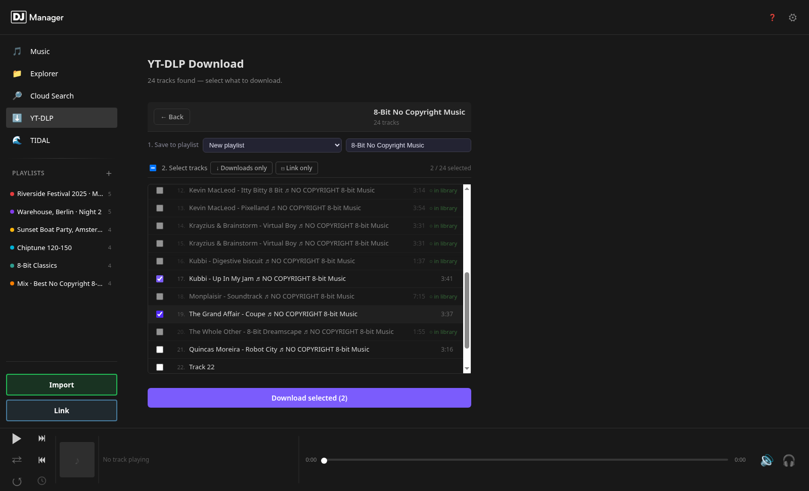

# DJ Manager

**Your whole DJ library in one window.** DJ Manager keeps your tracks organised, tells you what you are actually looking at (BPM, key, loudness, waveforms), helps you prepare a track before the set, and puts everything on a Pioneer USB stick that CDJs read without a laptop.



<sub>The screenshots use a demo library built from the public [8-Bit No Copyright Music](https://www.youtube.com/playlist?list=PLwJjxqYuirCLkq42mGw4XKGQlpZSfxsYd) playlist, with CC0 cover art.</sub>

---

## What it does

**Keeps the library tidy.** Import files or link them where they already live (no copying), then search by artist, genre, key or tempo. Playlists, ratings, artwork and comments stay in one place.

**Tells you what you are looking at.** BPM, musical key in both notations, loudness in LUFS and a coloured waveform, computed in the background while you keep working.

**Prepares a track properly.** The Prepare Track editor has a zoomable waveform, a beat grid you can nudge, tap tempo, hot cues A to H with colours, and trim points for the part you actually play.

**Levels the music.** Normalise a whole library or a selection to a target loudness, keeping the original file untouched so you can export either version.

**Gets you to the booth.** Export a playlist or the whole library to a USB stick with the full Pioneer layout: waveforms, beat grids, cues, playlists, artwork and hardware settings. Plug it into a CDJ and it is just there.

---

## Mix in key

Right-click any track and pick **Find similar**. The menu reads the track's key and tempo and offers the combinations a DJ actually uses: same key, adjacent key, minor to major, or compatible key with a similar tempo.



The choice becomes a query in the search bar, so you can see and edit it. Dropping the key chip leaves the tempo filter alone and widens the list from five tracks to nine, which is how you go from a safe mix to a wider one without retyping anything.

---

## Prepare Track

Open the row menu on any track and choose **Prepare Track**. Everything that makes a track playable in a set is in one window:



<sub>Seek into the track, pause, align the bar line with the playhead, drop a hot cue. Recorded from the demo library.</sub>

- **Detail waveform** with the beat grid drawn on top. Scroll to zoom, click or drag to seek.
- **Grid offset** in single milliseconds, plus tap tempo and a manual BPM field.
- **Hot cues A to H and memory cues**, each with a label and a colour, saved per track.
- **Trim** with Set IN and Set OUT, so only the part you play goes to the USB stick.
- **Apply** commits the grid, BPM, cues and trim together. Nothing is written until you say so.

In the recording above: seek into the track, start playback, pause, drag the waveform until a bar line sits under the playhead, then drop the hot cue. It lands on the beat, not somewhere near it.

---

## Downloads

Paste a link from YouTube, SoundCloud, Bandcamp and a thousand other sites, or pull a track from TIDAL, and it lands in the library with its metadata.



Paste a playlist, tick the tracks you want, and it downloads, analyses and imports them in one go. Tracks you already own are marked instead of downloaded again.

---

## Install

DJ Manager runs on **Windows**, **macOS (Apple Silicon)** and **Linux (x64)**.

**Download a build.** Installers for all three platforms are published on the [Releases page](../../releases).

| Platform | What you get             |
| -------- | ------------------------ |
| Windows  | NSIS installer (`.exe`)  |
| macOS    | `.dmg` for Apple Silicon |
| Linux    | AppImage (x64)           |

**Or build it yourself**, with Node 22:

```bash
npm install
cd renderer && npm install && cd ..
npm run dist:linux     # or dist:win, dist:mac
```

The first launch downloads FFmpeg and the analysis engine by itself. No account, no cloud library, no upload: your files stay on your machine and the app works offline.

## Good to know

- Everything lives in a normal SQLite database in your user folder, and the music stays wherever you keep it.
- Linked files are never copied or modified; normalisation writes a separate file next to the original.
- The USB export is a plain folder you can inspect, back up, or copy to another stick.
- Removing a track from the library does not touch the file, unless you explicitly choose to delete it.

---

## Under the hood

Electron, React and SQLite, with FFmpeg for decoding and waveforms. The interesting part is the Pioneer export: ANLZ sections and the DeviceSQL database are written byte for byte, which is what makes CDJs read the stick without a laptop.

Covers are cut from the image the library holds, at both sizes a deck asks for: 80 px for the file the database names and 240 px for the larger rendition, each centre-cropped and written as a high quality JPEG. On a CDJ-2000 the result was [reported sharper](https://github.com/Radexito/DjManager/issues/24#issuecomment-7088680890) than the same tracks on a stick prepared by rekordbox.

Architecture notes live in [CLAUDE.md](CLAUDE.md), and the test setup in [AGENTS.md](AGENTS.md).

---

## Development

```bash
npm run dev          # Vite + Electron, hot reload
npm test             # main process (Vitest)
cd renderer && npm test
npm run lint:all
npm run format
```

Close the app before running the tests: the pretest step rebuilds `better-sqlite3` and cannot do it while Electron holds the binary.

See [CONTRIBUTING.md](CONTRIBUTING.md) for the details.

---

## Credits

The Pioneer export stands on the shoulders of the reverse engineering community:

- **[meiremans](https://github.com/meiremans)**, [beirbox-gui](https://github.com/meiremans/beirbox-gui), for the overall USB layout, ANLZ sections and the DeviceSQL PDB structure.
- **[kimtore](https://github.com/kimtore)**, [rex](https://github.com/kimtore/rex), whose PDB writing logic we studied and rewrote in JavaScript.
- **[Deep-Symmetry](https://github.com/Deep-Symmetry)**, [crate-digger](https://github.com/Deep-Symmetry/crate-digger) and its Kaitai Struct definitions for the ANLZ binary layout.
- **[jandk](https://github.com/jandk)**, for working out how Pioneer derives the USBANLZ folder hash from a track path.
- **[bartvg](https://github.com/bartvg)**, for patiently listening to way too much bacon.

---

## License

MIT © [Radexito](https://github.com/Radexito)
